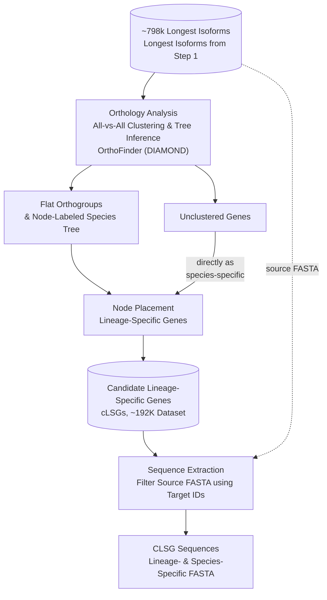

# Gene Stratigraphy Pipeline

A pipeline for stratifying genes by phylogenetic depth of origin, using OrthoFinder's flat Orthogroups output (`Orthogroups.tsv`) and a rooted species tree. For each focal species, every gene is assigned to the tree node at which its orthogroup first appears — from deeply conserved (shared with distant relatives) down to apparently private to that species alone (a candidate lineage-specific gene, or cLSG). The node is computed as the most recent common ancestor (MRCA), on the species tree, of every species sharing that gene's orthogroup — not read off a Hierarchical Orthogroups (HOG) table, which is structurally blind to any species outside the specific node it covers (see "Why `Orthogroups.tsv`, not a HOG table" below).

This is not an orthology inference tool. OrthoFinder does that. This tool consumes OrthoFinder's output and organizes it into a phylogenetically resolved layering — a stratigraphy — of a species' gene content.

## Pipeline overview



## What stratigraphy is useful for

- **Prioritizing candidates for de novo gene (DNG) identification.** Manually inspecting every gene in a proteome for evidence of lineage-specific or de novo origin is not tractable. Stratigraphy narrows a whole proteome down to the genes actually worth deeper scrutiny — phylogenetic placement, synteny, ORF-emergence tracing — instead of starting from everything.
- **A phylogenetically resolved view of gene content**, useful beyond DNG work: gene family turnover, lineage-specific expansions, and comparative genomics questions about which genes are conserved versus restricted to a given clade.
- **Genuinely multi-species, not pairwise.** Many gene-stratigraphy-style analyses compare one species against one reference at a time, typically via BLAST. This pipeline classifies each gene against an entire rooted species tree at once — a gene's stratigraphic placement (its MRCA) reflects its relationship to every species in the tree simultaneously, not just whichever one it happened to be compared against.
- **A fast, repeatable first pass**, not a final answer. Clustering can under-merge — miss a real relationship due to sequence divergence, domain rearrangement, or alignment noise (see the pairwise cross-check documentation below). Every output here is a *candidate*, meant to be filtered further before being treated as biologically real.

## Role in LINGUA

This is Stage 2 of the LINGUA comparative genomics framework:

1. Dataset curation (Stage 1 — protein preprocessing and isoform selection)
2. **Gene stratigraphy (this repository)** — orthology-based classification of genes by phylogenetic depth, producing candidate lineage-specific genes
3. Homolog exclusion (removal of false positives from the candidate list)
4. Synteny validation (genome alignment-based validation)

The candidate list this stage produces is deliberately over-inclusive rather than under-inclusive — Stage 3 and Stage 4 exist specifically to filter it further. Nothing coming out of this stage should be treated as a confirmed lineage-specific or de novo gene on its own.

## Requirements

- bash
- Python 3.7 or later
- [OrthoFinder](https://github.com/davidemms/OrthoFinder) installed and on `PATH` (for the generation step only — the classification step only reads OrthoFinder's output files, it doesn't call OrthoFinder itself)

No third-party Python dependencies; everything here is standard library.

### Installing OrthoFinder (conda, recommended)

```bash
conda config --add channels defaults
conda config --add channels bioconda
conda config --add channels conda-forge
```

Close and reopen your terminal so the channel changes take effect, then:

```bash
conda create -n orthofinder
conda activate orthofinder
conda install orthofinder
```

Confirm it's on `PATH`: `orthofinder -h`. See OrthoFinder's own [installation tutorial](https://davidemms.github.io/orthofinder_tutorials/alternative-ways-of-getting-OrthoFinder.html) for alternatives (Docker, source install) if conda isn't an option in your environment.

## Getting the pipeline

```bash
git clone https://github.com/Ludtson/gene-stratigraphy-pipeline.git
cd gene-stratigraphy-pipeline
```

## Two separate stages: generation and classification

Running OrthoFinder and classifying its output are kept as two separate commands, not one combined pipeline. OrthoFinder itself is the expensive part — many CPUs, long walltime, usually an HPC batch job — while classification is lightweight and gets iterated on far more often than the OrthoFinder run itself needs to be repeated. Keeping them separate means changing or re-running the classification logic never requires re-running OrthoFinder.

### 1. Generation: `scripts/run_orthofinder.sh`

Runs OrthoFinder (DIAMOND-based) on a directory of protein FASTA files, with optional species renaming and an optional pre-computed rooted species tree.

```bash
bash scripts/run_orthofinder.sh \
  -i step1_output \
  -o step2_output \
  -t 16
```

See `bash scripts/run_orthofinder.sh -h` for the full option list (`-m` for a species map file, `-s` for a rooted species tree, `-b` for branch lengths).

#### Branch lengths for the rooted species tree (optional)

Tools such as whole-genome aligners need a rooted species tree with branch lengths. A tree given with `-s` has a topology only, and OrthoFinder's own branch lengths depend on the tree method. `-b`/`--branch-lengths` adds maximum-likelihood branch lengths after the OrthoFinder run, keeping the topology and the root exactly as given: orthogroups with one gene per species are aligned with MAFFT, concatenated, and passed to `FastTree -nome -mllen -intree`; the FastTree output is re-rooted on the original root edge and its topology is checked against the input. Output: `Species_Tree/SpeciesTree_rooted_with_lengths.nwk` in the results directory. MAFFT and FastTree are OrthoFinder dependencies.

For an existing OrthoFinder run, call the script directly:

```bash
python bin/SpeciesTreeBranchLengths.py \
  --orthogroups step2_output/orthofinder/Results_*/Orthogroups/Orthogroups.tsv \
  --protein-dir step2_output/protein \
  --tree path/to/rooted_tree.nwk \
  --out SpeciesTree_rooted_with_lengths.nwk \
  --threads 16
```

If too few strictly single-copy orthogroups exist (e.g. many polyploids), `--min-species-frac 0.8` also accepts orthogroups missing up to 20% of species (filled with gaps). `--max-orthogroups` (default 1000) caps the run time.

### 2. Classification: `bin/OrthoFinderDataProcessor.py`

Reads OrthoFinder's results and produces the stratified candidate lineage-specific gene lists.

```bash
python bin/OrthoFinderDataProcessor.py output_dir \
  --orthofinder_dir step2_output/orthofinder \
  --prt_dir step2_output/protein
```

**`--prt_dir` must point at `step2_output/protein` (the copy `run_orthofinder.sh` made), not Step 1's own output directory.** `--prt_dir` is where the *entire gene universe to classify* comes from — every gene in a species' protein FASTA gets classified, not just genes already in `Orthogroups.tsv` (absence from `Orthogroups.tsv` is how `species_specific_unclustered` genes are identified in the first place). Each species' protein FASTA is looked up by the exact species name OrthoFinder used internally (e.g. `SpeciesA.faa`) directly under `--prt_dir` — no suffix handling, no species-map fallback for this lookup. `run_orthofinder.sh`'s `protein/` subdirectory always has that clean name already, because that's the same copy it fed to OrthoFinder (stripping Step 1's fixed `<species>_final.faa` naming convention when no map file is given — see `run_orthofinder.sh -h`). Step 1's raw output directory generally won't match, and a mismatch fails silently: a logged warning, and that species is skipped entirely rather than partially classified.

Key options:

- `--orthogroups-filename` (default `Orthogroups.tsv`) — the primary classification source; auto-located under `--orthofinder_dir`, rarely needs to be set manually.
- `--hog-filename` (default `N0.tsv`) — optional, secondary. A Hierarchical Orthogroups file used only to cross-validate the primary classification, gene by gene (see "HOG cross-validation" below). Not required to run the pipeline; if not found, this validation is just skipped, with a warning, not an error. Point it at `N1.tsv`/`N2.tsv`/etc. if you want validation against a different node file, or use `--skip-hog-validation` to skip it entirely without even looking for one.
- `--orthologues-dirname` — input for the pairwise cross-check (see below); auto-located the same way.
- `--skip-cross-check` — explicitly disables the pairwise cross-check. Only use this if you understand the consequence (see below).
- `--species-map` — optional CSV/TSV with `Species`/`Basename` columns to rename files to full species names in the output.

## Why `Orthogroups.tsv`, not a HOG table

Earlier versions of this pipeline classified genes directly from a Hierarchical Orthogroups (HOG) file (`Phylogenetic_Hierarchical_Orthogroups/N0.tsv`, `N1.tsv`, ...). That approach has a structural blind spot: whichever `N?.tsv` file is used, **every species outside the clade that node covers is invisible to it** — not just a nominal "outgroup," any species outside the chosen node, for any reason that file was chosen. Concretely, if an outgroup is used to work around OrthoFinder not emitting `N0.tsv` for the ingroup of interest (OrthoFinder's own README: *"If outgroup species are used, refer to `Species_Tree/SpeciesTree_rooted_node_labels.txt` to determine which N?.tsv file that contains the orthogroups you require"*), the outgroup has zero visibility in that file — every gene that's actually shared with it gets misclassified as narrower than it really is, and the outgroup itself can't be processed as a focal species at all, since it has no data in the HOG file to classify from.

`Orthogroups.tsv` — OrthoFinder's flat, whole-dataset clustering — has no such blind spot: it always includes every species OrthoFinder was run on. It doesn't carry per-node depth directly the way a HOG table does, but it doesn't need to: given the set of species sharing a gene's orthogroup, the correct stratigraphic node is the **most recent common ancestor (MRCA)** of that set on the actual species tree, computed directly from tree topology (`SpeciesTree.get_mrca`, `bin/OrthoFinderTreeParser.py`). `OrthogroupsStratigraphyClassifier.py` implements this and is the primary classification source.

A HOG table remains useful as an optional, secondary cross-validation — see below — but it's no longer required to run the pipeline at all.

## HOG cross-validation (optional)

If a HOG table is available (`--hog-filename`, default `N0.tsv`, auto-falls-back-and-suggests `N1.tsv`/etc. if not found), every gene visible in it is compared against the primary `Orthogroups.tsv`-derived node, using the same MRCA mechanism applied to the HOG table's own species membership instead. Disagreements are logged to `hog_disagreements.tsv`, each tagged with a diagnosed reason:

- `missing_species_from_hog` — the gene's `Orthogroups.tsv` species set includes a species that has **zero actual entries anywhere** in the HOG table (not just "isn't a header column" — a species can be a header column with every cell empty, which is exactly the outgroup-blindness case above). This fully explains the disagreement.
- `unexplained` — no missing species explains it. This is most likely genuine divergence between similarity clustering and tree reconciliation (HOG tables are built by a separate, later OrthoFinder step — gene-tree reconciliation against the species tree, which can split a flat orthogroup across nodes based on duplication/loss events) — not necessarily an error, but not assumed to be explained either.

This never blocks the pipeline — every disagreement is logged, none change the primary classification. Skip it entirely (without even trying to find a HOG file) with `--skip-hog-validation`.

## Pairwise cross-check

Clustering can under-merge — miss a real relationship due to sequence divergence, domain rearrangement, or alignment noise — even though `Orthogroups.tsv` itself has no blind spot for species coverage. `OrthologyCrossChecker` (`bin/OrthologyCrossChecker.py`) checks every candidate species-specific gene against OrthoFinder's pairwise `Orthologues/Orthologues_<species>/*.tsv` files (reciprocal-best-hit, tree-refined) — a genuinely independent method from clustering. A gene with a real pairwise ortholog is excluded, and the exclusion is logged (`cross_check_exclusions.tsv`: gene ID, original classification, conflicting species/gene) — auditable, not silent. Mandatory by default; `--skip-cross-check` is the explicit opt-out if the input genuinely isn't available.

`c_lsg_summary.csv`/`global_summary.csv` report `total_candidate_percentage` (before this check) and `verified_candidate_percentage` (after) side by side, so its effect is directly visible per species, not hidden behind a single changed number.

## Stats validation (automatic when available)

If OrthoFinder's own `Statistics_PerSpecies.tsv` is available (`--stats-filename`), this pipeline's computed species-specific-clustered and species-specific-unclustered counts are checked against OrthoFinder's own self-reported numbers for each species — both are ultimately derived from `Orthogroups.tsv`, so they should match exactly. A mismatch means this pipeline's own counting logic disagrees with OrthoFinder's and is logged to `stats_validation_mismatches.tsv`, worth investigating rather than trusting silently. This is a real check on the pipeline's own arithmetic, not a way to validate the HOG cross-validation above (`Statistics_PerSpecies.tsv` has zero visibility into HOG-table data at all — see `bin/OrthoFinderStatsProcessor.py`).

## Verifying results independently

`bin/CLSGClassificationVerifier.py` re-derives each gene's node from `Orthogroups.tsv` and the species tree, using the same MRCA rule as the classifier but re-parsing `Orthogroups.tsv` itself and sharing no classifier code, so a bug in the classification logic can't silently cancel out. Every gene listed in a `gene_IDs_by_node/<species>_<node>_gene_ids.txt` file must have that node as its re-derived node. A HOG table is optional (`--hog-tsv`): it adds a secondary consistency check whose findings are reported as notes and never affect the exit status, since a HOG table cannot see species outside the clade it covers.

```bash
python bin/CLSGClassificationVerifier.py \
  --orthogroups-tsv path/to/Orthogroups.tsv \
  --tree path/to/SpeciesTree_rooted_node_labels.txt \
  --results-dir output_dir \
  --report violations_report.tsv
```

Exits non-zero if any violation is found, so it can be used as a CI gate, not just a manual report.

## Output structure

```
output_dir/
  <species>/
    gene_IDs_by_node/       # gene IDs per stratigraphic node (N0, N1, ..., species_specific_clustered/unclustered), plus the final candidate_lsg list
    proteins_by_node/       # protein FASTA per node, same buckets, plus the final candidate_LSGs FASTA
    <species>_summary_per_node.csv
  intermediate/                    # SpeciesStats.csv, c_lsg_summary.csv, global_gene_counts_per_node.tsv
  C_LSG_Iso.tsv                    # every gene, every species, one row each (node + Orthogroup ID)
  global_summary.csv               # canonical master table (merges the intermediate/ files)
  cross_check_exclusions.tsv       # audit log of every pairwise cross-check exclusion
  hog_disagreements.tsv            # audit log of every Orthogroups.tsv-vs-HOG-table disagreement (only if a HOG file was found)
  stats_validation_mismatches.tsv  # audit log of any mismatch against OrthoFinder's own stats (only if the stats file was found)
  OrthoFinderDataProcessor.log
```

## Components (`bin/`)

- `OrthoFinderDataProcessor.py` — orchestrates classification for every species
- `OrthogroupsStratigraphyClassifier.py` — the primary classifier: parses `Orthogroups.tsv`, derives each gene's node via MRCA
- `OrthoFinderTreeParser.py` — parses the rooted species tree, walks ancestry, computes MRCA
- `OrthologyCrossChecker.py` — the mandatory pairwise-Orthologues cross-check
- `CLSGClassificationVerifier.py` — independent re-derivation of every gene's node from `Orthogroups.tsv` and the tree
- `OrthoFinderStatsProcessor.py` — converts OrthoFinder's per-species stats to CSV
- `CSVFileMerger.py` — merges the intermediate tables into the master table
- `FastaGeneFilter.py` — extracts a gene-ID subset from a FASTA file
- `SpeciesTreeBranchLengths.py` — adds ML branch lengths to a fixed rooted species tree (used by `run_orthofinder.sh -b`)

## Contributing

See [CONTRIBUTING.md](CONTRIBUTING.md) for how to run the reproducibility check against `example_data/`, coding style expectations, and the pull request process.

## Citation

If you use this pipeline, please cite it via [CITATION.cff](CITATION.cff) (GitHub also surfaces this as a "Cite this repository" option on the repo page).

## License

MIT License. See [LICENSE](LICENSE).

## Acknowledgements

Casola Lab, Ecology & Conservation Biology Program, Texas A&M University.

